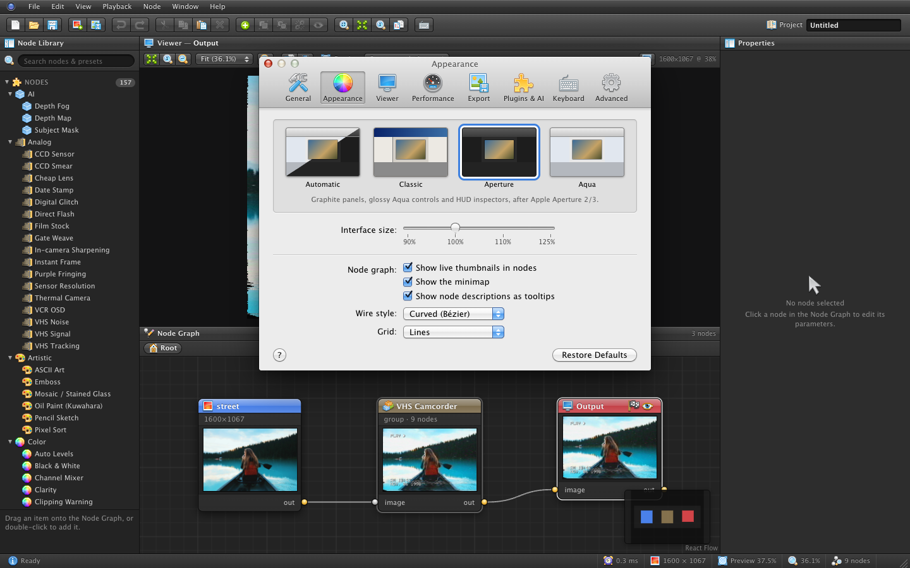
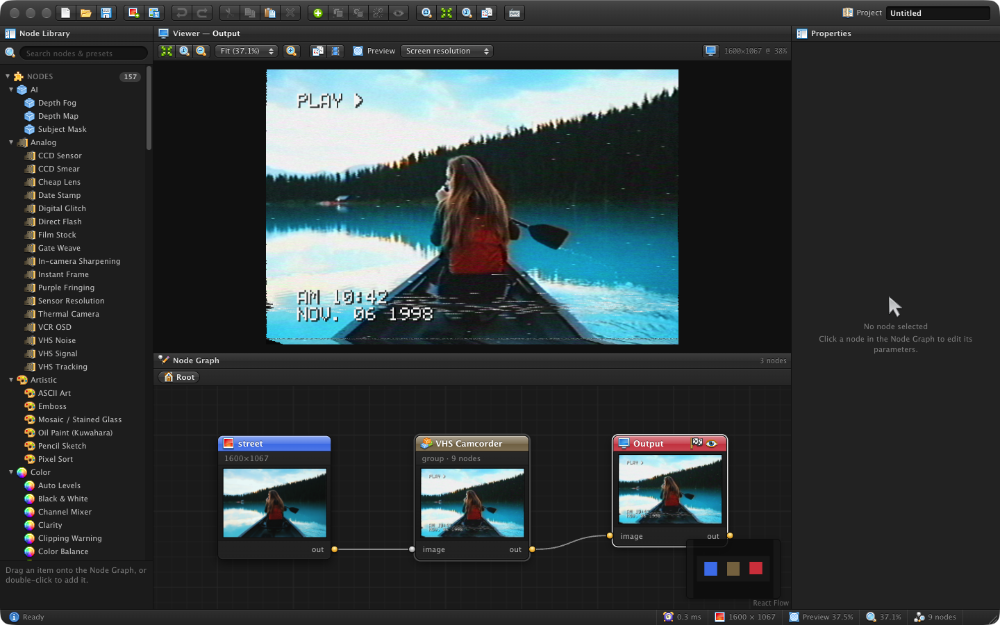
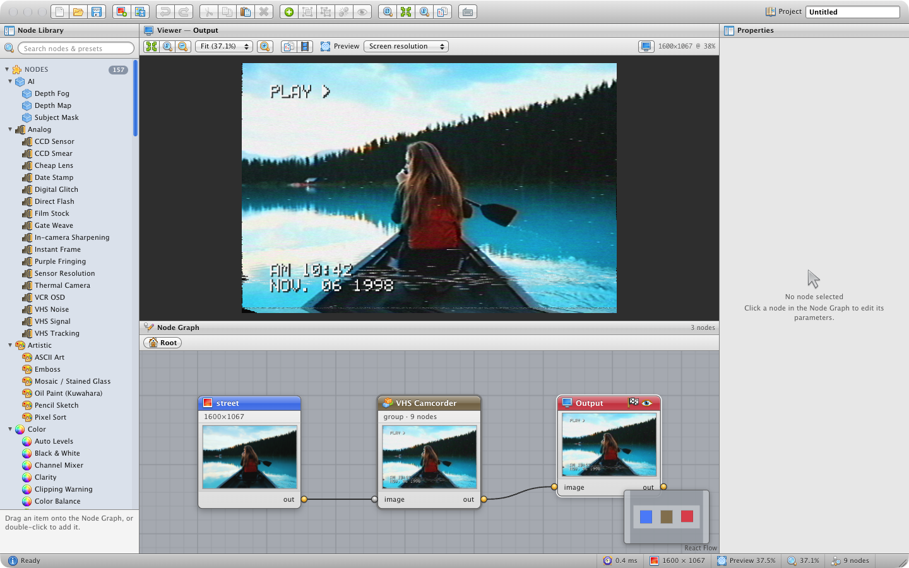

<p align="center">
  
</p>

<p align="center">
  <b>Wire up GPU shader nodes to make any photo look like it came from a 2002 digicam, a disposable camera, a VHS tape, a risograph — or something stranger.</b>
</p>

<p align="center">
  <a href="#getting-started">Getting started</a> ·
  <a href="#preset-gallery">Gallery</a> ·
  <a href="#nodes">Nodes</a> ·
  <a href="#custom-nodes--plugins">Custom nodes & plugins</a> ·
  <a href="docs/NODE_AUTHORING.md">Node authoring guide</a>
</p>

---

<p align="center">
  
</p>

Darkroom is a non-destructive, node-based image editor that runs entirely in the browser. Every node is a
WebGL2 fragment shader. You chain them into a graph, tweak parameters, and see the result live. Groups of
nodes become reusable **presets**: "2002 Digicam (1.3 MP CCD)" is not a LUT, it is a chain of sensor
resolution, CCD clipping, smear, purple fringing, in-camera sharpening and a real 8×8 DCT JPEG round
trip. You can open any preset and take it apart.

## Features

- **Node graph editor.** Typed sockets, quick-add (<kbd>Tab</kbd>), drag-and-drop images, copy/paste,
  undo/redo, bypass, groups/subgraphs with exposed parameters, and a breadcrumb into nested groups.
- **Live node thumbnails.** Every node shows a small preview of its output, including side branches
  that don't reach the output. Click a thumbnail to view that node. Toggle with *View › Node Thumbnails*.
- **GPU engine.** WebGL2 with RGBA16F buffers, multi-pass nodes, CPU steps for text/LUTs/histograms,
  and per-node caching, so only what changed re-renders. The preview renders at screen resolution and
  export at full resolution, with scale-aware shaders so both look the same.
- **About 160 nodes** across Input, Color, Filter, Distort, Transform, Mask, Composite, Math, Stylize,
  Analog, Print, Process, Artistic, Optical, Retro and AI.
- **30 presets** emulating cameras, video formats, print processes and 19th-century photography, plus
  AI-driven looks such as portrait bokeh and real-depth tilt-shift.
- **Pro photo tools.** Scene-linear tone mapping (AgX, ACES, Filmic…), colour-space conversion, lens
  correction, Lightroom-style graduated / radial filters with on-image handles, dodge & burn and healing
  brushes, HDR merge, exposure fusion, focus stacking, smart sharpening, and *File › Export LUT (.cube)*
  to bake a colour grade into a 3D LUT for other apps. See [docs/FILTERS.md](docs/FILTERS.md).
- **Custom nodes.** A **GLSL Shader** node for quick one-offs, and a **Node Builder** that turns
  annotated GLSL (`// @param min=0 max=2`) into a reusable node type with sliders. Custom types are
  embedded in project files, so shared projects keep working.
- **Plugins.** Safe JSON shader packs, and JavaScript plugins (behind a trust prompt) with access to
  CPU steps and the preset builder. Managed in a Plugin Manager.
- **In-browser AI.** A Depth Map (Depth Anything V2) and a Subject Mask (MODNet / U²-Net-p), run
  locally with ONNX Runtime Web (WebGPU, or WASM on the CPU). They drive a depth-aware tilt-shift,
  real 3D anaglyphs, depth fog and portrait bokeh. Models download once and then work offline. See
  [docs/AI.md](docs/AI.md).
- **Click to select, scene segmentation and relighting.** Select a node with a viewer tool and work
  in the viewer: click objects to select them (Segment Anything: SlimSAM), paint masks with a brush,
  or drag a light. Scene Segmentation (DETR panoptic) finds sky, people, vegetation, water, buildings…
  for sky swaps.
- **AI relighting with shadows.** Surface Normals (MoGe-2) estimates the shape of faces and objects;
  Relight then removes much of the existing light and adds up to three point, spot or directional lights
  with soft area-light shadows, contact shadows and ambient occlusion. Drag the lights in the viewer in
  real time. Presets: *Studio Portrait Light*, *Rim Light*, *Golden Hour*, *Overhead Noon*, *Neon
  Two-Tone*, *Candlelight* and *Dramatic Relight*. Why there is no diffusion relighter (IC-Light) yet:
  [docs/AI.md](docs/AI.md#relighting).
- **AI restoration and creative filters.** Upscale 2×/4× (Real-ESRGAN, tiled), Remove Object (LaMa
  inpainting, from any mask), Colorize B&W (DDColor), Neural Style (fast neural style), Low-Light
  Enhance (Zero-DCE) and AI Line Art (Informative Drawings), plus presets such as *Restore Old Photo*
  (scratch removal → colorize → upscale) and *Night Rescue*. All run locally; see [docs/AI.md](docs/AI.md).
- **AI denoise and sky replacement.** AI Denoise (SCUNet, tiled, separate luma/colour amounts and detail
  recovery) cleans high-ISO noise. Sky Mask (a dedicated sky network plus guided-filter matting for
  branches and hair) also gives a horizon gradient for graduated filters. Sky Replace swaps in any image
  or a procedural sunset, blue, overcast, night or stormy sky, relights the foreground and defringes edges.
- **AI for people.** Face Detection & Landmarks (478-point mesh: face, skin, eye, lip and brow masks,
  even for the small faces of group photos), Face Restoration (RestoreFormer++ or GFPGAN), Pose / Body
  (skeleton, person, hair, skin and clothes masks) and Smart Auto-Crop (keeps faces whole, with
  headroom and rule-of-thirds placement), plus *Beauty Retouch*, *Hair Recolor*, *Restore Portrait*,
  *Motion Capture* and *Instagram Crop 4:5* presets. Runs locally; see [docs/AI.md](docs/AI.md).
- **Vision-language AI.** Select by Text (type “red jacket, paddle”: OWLv2 finds it, SAM traces it), Text Mask
  (CLIPSeg soft masks for “sky”, “water”, “skin”, with `-` to subtract), Caption & OCR (Florence-2: captions,
  reading text, object detection, phrase grounding; copy the text or use it as the project name), and a
  *Describe a look…* CLIP search plus *More like this* in the Preset Browser. Presets *Recolour by Text*,
  *Blur All But…* and *Cut Out by Text*. Runs locally; see [docs/AI.md](docs/AI.md#vision-language-text-prompts-captions-ocr-clip-search).
- **AI motion, slow motion, style and cutouts.** Optical Flow (NeuFlow v2 / RAFT, with a Middlebury colour-wheel view)
  drives Flow Motion Blur (shutter angle), Flow Warp and a real Datamosh that smears the previous frames along the motion.
  Frame Interpolation (RIFE) makes in-between frames, and *Export Video › Smooth slow motion ×2 / ×4* renders AI slow
  motion from any video. Style from Image (AdaIN) repaints a photo in the style of any painting you connect. Background
  Removal (BiRefNet) gives hair-detail cutouts with edge colour decontamination. Presets: *Datamosh*, *Motion Blur*,
  *Painting from Image*, *Hair-Detail Cutout*. See [docs/AI.md](docs/AI.md#motion-interpolation-style-from-image-and-matting).
- **ControlNet.** Preprocessor nodes that make control maps exactly as the A1111 / ComfyUI preprocessors do:
  Canny, Soft Edge, Scribble, M-LSD lines, Lineart, Depth, Normal (BAE), OpenPose (body, hands, face),
  Segmentation (ADE20K colours), Content Shuffle, Tile and Color Grid, plus a Control Sheet. *Generate
  (Stable Diffusion)* sends maps to **your own** ComfyUI or AUTOMATIC1111 / Forge server (off by default;
  Preferences › Generation). Presets: *All Control Maps*, *Restyle*, *Pose Transfer*. See
  [docs/CONTROLNET.md](docs/CONTROLNET.md).
  Presets: *Sunset Sky*, *Dramatic Sky*, *Clean High ISO*, *Graduated Filter*.
- **Themes that follow your system.** *Auto* (the default) uses *Aperture* (dark graphite Aqua) in
  Dark Mode and *Aqua* (light Leopard) in Light Mode. *Classic* (a 2000s Windows pro tool) is also available.
- **Snow Leopard–style Preferences** (<kbd>⌘</kbd>+<kbd>,</kbd>) with eight panes: General, Appearance,
  Viewer, Performance (GPU info), Export (filename patterns), Plugins & AI (model cache), Keyboard
  (rebindable shortcuts) and Advanced (import/export settings).
- **Native Mac app.** A standalone Electron build with a native menu bar, native dialogs, Finder file
  associations and Open Recent. See [Mac app](#mac-app).
- **Pro viewer.** Zoom/pan (fit, fill, 1:1, Space+drag), pixel-exact zoom above 100%, scopes
  (histogram, waveform, vectorscope with skin-tone line and 75% targets, RGB parade), a pixel readout
  with up to four colour samplers, an eyedropper on every colour parameter, channel (R/G/B/A/luma) and
  clipping views, and A/B compare (left/right, top/bottom or hold <kbd>\\</kbd>) against the source, a
  pinned node or a snapshot. View → Preset Browser shows every preset applied to your image as a live
  thumbnail. False-colour/gamut/histogram nodes are there too.
- **Projects.** `.darkroom` files with embedded images and custom nodes. Autosaves to IndexedDB. Exports
  PNG, JPEG or WebP at full resolution.
- **Camera RAW.** DNG, CR2, CR3, NEF, ARW, RAF, ORF, RW2, PEF, SRW and more, developed with LibRaw
  (WebAssembly, in a worker) by a **RAW Photo** node: white balance, exposure, highlight recovery,
  demosaic and noise reduction, with the full 16-bit data on the GPU. See
  [docs/RAW_AND_BATCH.md](docs/RAW_AND_BATCH.md).
- **Bridge-style file browser.** The *Browse* and *Filmstrip* workspaces turn Darkroom into an Adobe
  Bridge: Folders, Favorites, a virtualised thumbnail grid / details list / filmstrip (QuickLook thumbnails
  in the Mac app), Preview with 2–4-up compare and full-screen Review (<kbd>Space</kbd>), Metadata (EXIF,
  editable IPTC Core, GPS), Keywords, a Filter panel with facet counts, and Collections / Smart
  Collections. Ratings (<kbd>0</kbd>–<kbd>5</kbd>, Reject), Bridge's colour labels (<kbd>6</kbd>–<kbd>9</kbd>)
  and keywords go into XMP sidecars that Bridge and Lightroom read; image files are never modified.
  Batch Rename, Move to Trash, Reveal in Finder, drag thumbnails onto the graph or viewer, and
  <kbd>Enter</kbd> opens a photo, RAW, video or project in the editor. See [docs/BROWSER.md](docs/BROWSER.md).
- **Batch processing.** *File › Batch Process…* runs the current graph over many photos or a folder
  and saves a ZIP or writes into a folder, with progress, ETA and per-file errors.
- **Video.** Drop an MP4/WebM/MOV onto the graph for a **Video** node (frame-accurate WebCodecs
  decoding, trim/speed/loop), or add a live **Webcam** node. A timeline bar under the viewer plays,
  scrubs and steps frames (<kbd>Space</kbd>, <kbd>←</kbd>/<kbd>→</kbd>); grain, VHS noise, glitch and
  gate weave move every frame, even on a still photo (*Playback › Animate*). *File › Export Video…*
  renders offline to MP4 (H.264) or WebM (VP9) with optional audio passthrough. Still exports are
  unchanged. See [docs/VIDEO.md](docs/VIDEO.md).
- **Installable PWA.** Works offline once loaded. Share photos to Darkroom from the OS share sheet,
  or use it to open `.darkroom`, image and RAW files.

## Preset gallery

All renders below come straight from the built-in presets at default settings.

| | | |
|:-:|:-:|:-:|
| <br>**2002 Digicam (1.3 MP CCD)** | <br>**Disposable Film Camera** | <br>**VHS Camcorder** |
| <br>**Riso Zine (2-colour)** | <br>**Riso 3-Colour** | <br>**Screenprint** |
| <br>**Tintype (wet plate)** | <br>**Cyanotype** | <br>**Aerochrome Infrared** |
| <br>**Instant Film** | <br>**Toy Camera (Lomo)** | <br>**Super 8** |
| <br>**Game Boy Camera** | <br>**MacPaint (Atkinson dither)** | <br>**PICO-8** |
| <br>**CRT Monitor** | <br>**ASCII Terminal** | <br>**Glitch** |
| <br>**Oil Painting (Kuwahara)** | <br>**Photocopy Zine** | <br>**Newspaper Halftone** |
| <br>**Thermal Camera** | <br>**Miniature (tilt-shift)** | <br>**2005 Webcam** |

<details>
<summary>Original sample photos</summary>

| | | |
|:-:|:-:|:-:|
|  |  |  |

</details>

## Themes

| Classic | Aperture | Aqua |
|:-:|:-:|:-:|
|  |  |  |

<p align="center"></p>

Switch themes under **View → Theme** or in **Edit → Preferences…** (<kbd>Ctrl</kbd>/<kbd>⌘</kbd>+<kbd>,</kbd>).
The default, **Auto (match system)**, uses Aperture when the system is in Dark Mode and Aqua in Light
Mode, and switches live when the system appearance changes. The choice is remembered.

## Getting started

Requirements: Node 20+ and [pnpm](https://pnpm.io). The browser needs WebGL2 with
`EXT_color_buffer_float`. Darkroom is developed and tested in Chromium-based browsers (Chrome, Edge,
Arc); Safari and Firefox should work but are less tested.

```bash
git clone https://github.com/Bloxmine/darkroom.git
cd darkroom
pnpm install
pnpm dev          # http://localhost:5173
```

```bash
pnpm build        # production build in dist/ (includes the service worker)
pnpm preview      # serve the build locally; install it as an app from the address bar
pnpm test         # unit tests (vitest)
pnpm typecheck
```

On first launch Darkroom opens a starter project: a sample photo → *VHS Camcorder* → Output. Drop your
own photo onto the node graph, swap the preset from the **Node Library**, and export with
<kbd>Ctrl</kbd>/<kbd>⌘</kbd>+<kbd>E</kbd>.

### Basics

| Action | How |
|---|---|
| Add a node or preset | <kbd>Tab</kbd> or right-click on the graph, or drag from the library |
| Connect | Drag from an output socket to an input. Drop on empty space to add and connect a node |
| View a node's output | Select it and press <kbd>1</kbd> |
| Bypass | <kbd>B</kbd> |
| Group / ungroup | <kbd>Ctrl</kbd>+<kbd>G</kbd> / <kbd>Ctrl</kbd>+<kbd>Shift</kbd>+<kbd>G</kbd> |
| Enter / leave a group | <kbd>Ctrl</kbd>+<kbd>Enter</kbd> / <kbd>Ctrl</kbd>+<kbd>Backspace</kbd> |
| Expose a parameter on its group | Right-click the parameter → *Expose on Group* |
| Compare with the original | <kbd>C</kbd> (drag the split knob); hold <kbd>\\</kbd> to flash the reference; <kbd>Shift</kbd>+<kbd>T</kbd> snapshot |
| Scopes / preset browser | <kbd>Shift</kbd>+<kbd>S</kbd> / <kbd>Shift</kbd>+<kbd>P</kbd> |
| Colour sampler / eyedropper | <kbd>Shift</kbd>-click the image / the pipette next to a colour parameter |
| Channel view / clipping | <kbd>Alt</kbd>+<kbd>1</kbd>–<kbd>5</kbd> (<kbd>Alt</kbd>+<kbd>0</kbd> = RGB) / <kbd>J</kbd> |
| Save / open / export | <kbd>Ctrl</kbd>+<kbd>S</kbd> / <kbd>Ctrl</kbd>+<kbd>O</kbd> / <kbd>Ctrl</kbd>+<kbd>E</kbd> |

On macOS, <kbd>⌘</kbd> works wherever <kbd>Ctrl</kbd> is listed. Help → Keyboard Shortcuts has the full list.

### Node graph editing

| Action | How |
|---|---|
| Insert a node on a wire | Drag it onto the wire (the wire lights up; hold <kbd>Alt</kbd> to just move), or hover a wire and press <kbd>Tab</kbd> |
| Remove / rewire a connection | <kbd>Alt</kbd>-click the wire · <kbd>Ctrl</kbd>/<kbd>⌘</kbd>-drag from a connected input to move its wire · <kbd>Ctrl</kbd> + right-drag across wires to cut them |
| Tidy up | <kbd>Shift</kbd>+<kbd>L</kbd> lays out the selection (or everything) left to right · Node → Arrange for align / distribute |
| Frames and sticky notes | <kbd>Ctrl</kbd>+<kbd>J</kbd> frames the selection, <kbd>Shift</kbd>+<kbd>N</kbd> adds a note; drag a frame by its title to move its nodes, double-click to rename |
| Rename / collapse / colour | Double-click a node's title or <kbd>F2</kbd> · <kbd>H</kbd> or the ▾ button · right-click → *Colour Tag* |
| Bypass (mute) | Click the node's icon, or <kbd>B</kbd> |
| Select upstream / downstream | <kbd>Shift</kbd>+<kbd>←</kbd> / <kbd>Shift</kbd>+<kbd>→</kbd> |
| Favourites | Click ☆ in the library or the <kbd>Tab</kbd> search; favourites and recent nodes are listed first |
| Save your own preset | Select a group (or nodes) → Node → *Save as Preset…*; it appears under **My Presets** (right-click to rename, export or delete) |
| Minimap | Corner button or <kbd>Shift</kbd>+<kbd>M</kbd>; right-click the button to move it |

With a node selected, new nodes go to its right and are connected to it (Preferences → General).

### Workspaces and panels

Panels dock like Adobe Bridge CS3. Drag a panel's tab onto another panel to dock it to the left, right,
top or bottom (or drop it on the tab bar to make it a tab there; near the window edge to dock along the
edge). Drag the splitters to resize, double-click a tab to maximize it, and use the panel menu (≡) to
minimize a group to a slim bar, close a panel or add another one. Window lists every panel.

The switcher at the right of the toolbar holds three workspaces (right-click one to keep it there); its
▾ menu and **Window → Workspace** list all of them:

| Workspace | Layout | Shortcut |
|---|---|---|
| Essentials | Library · Viewer over Node Graph · Properties | <kbd>Ctrl</kbd>+<kbd>F1</kbd> |
| Browse | Folders / Favorites / Collections + Filter · Content · Preview over Metadata / Keywords | <kbd>Ctrl</kbd>+<kbd>F2</kbd> |
| Filmstrip | Large Preview with the Filmstrip along the bottom | <kbd>Ctrl</kbd>+<kbd>F3</kbd> |
| Light Table | Content only | <kbd>Ctrl</kbd>+<kbd>F4</kbd> |
| Graph | Large Node Graph with Library, a small Viewer and Properties | <kbd>Ctrl</kbd>+<kbd>F5</kbd> |
| Viewer | Large Viewer with Scopes and Properties (graph minimized) | <kbd>Ctrl</kbd>+<kbd>F6</kbd> |
| Metadata | Content and a large Metadata panel | |

Rearrangements are remembered per workspace until **Reset Workspace**. **New Workspace…** saves the
current arrangement under a name (an existing name is overwritten); your workspaces can be renamed and
deleted, and travel with Preferences → Advanced → Export. Preferences → General picks the workspace
opened at launch (or remembers the last one).

The **Node Library** has four views (buttons in its header): **List** (the tree), **Icons** (large icons
or, with *Previews* on, each node applied to the current image; size slider at the bottom), **Details**
(a table sortable by name, category, kind, description, inputs, outputs) and **Compact** (dense rows,
in columns when wide). Filter by category and sort A–Z, by category or by recent use; arrow keys move the
selection, <kbd>Enter</kbd> adds, <kbd>Space</kbd> stars.

## Mac app

| Dark Mode | Light Mode |
|:-:|:-:|
|  |  |

Darkroom also ships as a standalone macOS app (Electron): native menu bar, native open/save dialogs,
real files on disk (Save overwrites in place, Save As…, Open Recent), the window title shows the
document with the unsaved-changes dot, and `.darkroom` projects and images (JPEG/PNG/WebP/HEIC/TIFF and
camera RAW) open from Finder or by dropping them on the Dock icon. It follows the system light/dark
appearance like the web version, and works fully offline.

**Requirements:** macOS 13 Ventura or later, on Apple silicon or Intel. The download is one universal
app that runs natively on both.

**Install:** open `Darkroom-<version>-universal.dmg` and drag Darkroom to Applications. The app is not
signed or notarized, so the first time macOS Gatekeeper will refuse to open it. **Right-click (or
Control-click) Darkroom in Applications → Open → Open.** After that it opens normally. (On recent
macOS versions you may instead need *System Settings → Privacy & Security → Open Anyway*. Or remove
the quarantine flag with `xattr -dr com.apple.quarantine /Applications/Darkroom.app`.)

**Build it yourself** (on a Mac, either architecture):

```bash
pnpm install
pnpm electron:build         # universal (arm64 + x86_64) → release/Darkroom-<version>-universal.dmg/.zip
pnpm electron:build:arm64   # Apple silicon only → release/Darkroom-<version>-arm64.dmg/.zip
pnpm electron:build:x64     # Intel only → release/Darkroom-<version>-x64.dmg/.zip
pnpm electron:dev           # Vite dev server + Electron with live reload (main/preload rebuild + restart)
pnpm electron:icon          # regenerate build/icon.icns from docs/media/logo.svg
```

Architecture, IPC surface and security choices: [docs/DESKTOP.md](docs/DESKTOP.md).

## Nodes

| Category | Highlights |
|---|---|
| **Input** | Image, RAW Photo, Solid Color, Gradient, Noise (value/Perlin/fBm), Text, Checker |
| **Color** | Levels, Curves, HSL, White Balance, Exposure, Color Balance, Channel Mixer, Gradient Map, 3D LUT (`.cube`), Auto Levels, Histogram Equalize, Clarity, Dehaze, Highlights/Shadows, Selective Color, Split Toning, Black & White mixer, Match Color, False Color, Gamut Warning |
| **Filter** | Gaussian/Box/Directional/Lens Blur, Sharpen, High Pass, Denoise, Surface Blur, Bilateral, Median, Min/Max, Glow, Edge Detect, Frequency Separation |
| **Transform & Distort** | Crop, Resize (Lanczos/bicubic/area), Rotate 90, Flip, Canvas Size, Straighten, Perspective, Tile, Lens Distortion, Chromatic Aberration, Displace, Pixelate, Downsample, Wave, Mirror, Polar |
| **Mask** | Paint Mask (brush in the viewer), Color Range, Luma Range, Shape, Linear/Radial Gradient, Edges, Blur, Combine, Invert, Levels, Mask View |
| **Composite & Math** | Blend (18 modes), Mix, Layer Stack, Alpha Over, Drop Shadow, Border, Math Op, Remap, GLSL Expression |
| **Analog** | CCD Sensor, CCD Smear, Purple Fringing, Sensor Resolution, In-camera Sharpening, Direct Flash, Cheap Lens, Film Stock, Date Stamp, VHS Signal/Tracking/Noise, VCR OSD, Instant Frame, Thermal Camera, Digital Glitch |
| **Stylize** | Film Grain, Vignette, Bloom, Halation, Light Leak, Posterize, Dither, Halftone, Scanlines, JPEG artefacts (real DCT), CRT |
| **Print** | Risograph (1–4 drums, 26 Riso inks, grain touch, misregistration), Riso Layer, Screenprint, Photocopy, Fax |
| **Process** | Cyanotype, Wet Plate (tintype/ambrotype/daguerreotype), Infrared (Aerochrome), Cross Process, Toning |
| **Artistic** | Oil Paint (anisotropic Kuwahara), Pencil Sketch, ASCII Art, Pixel Sort, Mosaic/Stained Glass, Emboss |
| **Optical** | Tilt-Shift, Zoom Blur, Radial Blur, Lens Flare, God Rays, Anaglyph 3D, Kaleidoscope |
| **Retro** | Palette Quantize (NES, PICO-8, C64, EGA, CGA, Mac Plus, Apple II, ZX Spectrum…), Error Diffusion (Atkinson, Floyd–Steinberg, JJN, Sierra), LCD subpixels |
| **Color Management** | Tone Map (AgX / ACES / Filmic / Reinhard / Uchimura / Hable), Colour Space Convert (sRGB, P3, Rec.2020, ProPhoto, Adobe RGB, ACEScg), Exposure & White Balance (linear), Hald CLUT, Look pack (Teal & Orange, Bleach Bypass, Kodachrome-ish, Cross Cool, Faded Matte, Day for Night…) |
| **Lens** | Lens Correction (Brown–Conrady distortion, vignetting, lateral CA, auto-crop), Defringe, Auto Straighten |
| **Local** | Graduated Filter and Radial Filter (drag the handles in the viewer), Dodge & Burn brush, Heal / Clone brush (Poisson-style healing) |
| **Photo** | Merge HDR (aligned, deghosted), Exposure Fusion (Mertens), Focus Stack, Smart Sharpen (edge-masked USM / Richardson–Lucy deblur), Texture |
| **Utility** | Output, Reroute, Info, Split Compare, Channel View, Histogram Overlay, GLSL Shader, Compare Grid, Watermark, Print Frame (gallery mat / film strip / negative carrier) |
| **AI** | Depth Map, Subject Mask, Depth Fog, Click Select (SAM), Scene Segmentation, Surface Normals, Relight, AI Upscale, Remove Object (LaMa), Colorize B&W, Neural Style, Low-Light Enhance, AI Line Art, AI Denoise, Sky Mask, Sky Replace, Face Detection & Landmarks, Face Restoration, Pose / Body, Smart Auto-Crop, Select by Text, Text Mask (CLIPSeg), Caption & OCR, Optical Flow, Frame Interpolation (RIFE), Smooth Slow Motion, Style from Image, Background Removal (BiRefNet) (models run in the browser, see [docs/AI.md](docs/AI.md)) |
| **ControlNet** | Canny, Soft Edge, Scribble, M-LSD Lines, Lineart, Depth, Normal Map, OpenPose, Segmentation, Content Shuffle, Tile / Blur, Color Grid, Inpaint Mask, Control Sheet, Generate (Stable Diffusion) (see [docs/CONTROLNET.md](docs/CONTROLNET.md)) |

## Custom nodes & plugins

<p align="center">
  
  
</p>

**Node Builder** (Node → New Custom Node…). Write GLSL ES 3.00. Uniforms annotated with `@param` become
sliders, colour pickers, checkboxes and dropdowns:

```glsl
uniform float u_amount; // @param min=0 max=2 default=1 label="Amount"
uniform vec4  u_tint;   // @param color default=1,0.6,0.3,1

void main() {
  vec4 c = texture(u_image, v_uv);
  fragColor = vec4(mix(c.rgb, c.rgb * u_tint.rgb, u_amount), c.a);
}
```

Nodes can have several passes, inputs and outputs, and work at a smaller resolution. Compile errors show
inline at your own line numbers. See [docs/CUSTOM_NODES.md](docs/CUSTOM_NODES.md).

**Plugins** (Edit → Plugins…) come in two tiers:

- **Data plugins** (`.drplugin.json`): shader-only nodes and presets. Safe, so they install without a prompt.
- **Code plugins** (`.js` ES modules): can add CPU steps, canvas drawing and programmatic presets. They run
  arbitrary JavaScript, so Darkroom asks you to trust each one first.

```js
// my-plugin.js
export default ({ defineNode, GraphBuilder }) => ({
  id: 'me.myPlugin', name: 'My Plugin', version: '1.0.0',
  nodes: [defineNode({
    id: 'me.posterTint', name: 'Poster Tint', category: 'My Plugin',
    inputs: { image: { type: 'image' } },
    params: { levels: { type: 'int', default: 4, min: 2, max: 16 } },
    passes: [{ frag: `void main(){ vec4 c = texture(u_image, v_uv);
      fragColor = vec4(floor(c.rgb * float(u_levels)) / float(u_levels), c.a); }` }],
  })],
});
```

Example plugins live in [`public/plugins/`](public/plugins/). The format and API are documented in
[docs/PLUGINS.md](docs/PLUGINS.md), and built-in nodes follow [docs/NODE_AUTHORING.md](docs/NODE_AUTHORING.md).

## How it works

```
src/
  core/        engine (graph evaluation, caching, WebGL2), types, registry, groups, GLSL library,
               serialization, plugin loader
  nodes/       built-in nodes, auto-registered from library/, analog/, effects/, custom/
  presets/     presets built with GraphBuilder
  store/       Zustand document store, undo/redo, project I/O, autosave, settings
  ui/          editor (React + React Flow), themes, Node Builder, Plugin Manager
scripts/
  snap.mjs     render any node/preset headlessly to PNG (used for visual testing)
  app-snap.mjs screenshot the full editor with scripted interactions
```

- The engine flattens groups, evaluates the graph back from the viewed node and caches every node's output
  texture by a key made of its params and its inputs' keys, so moving one slider only re-renders the
  nodes downstream of it.
- Shaders get an auto-generated header with every input sampler, param uniform and a shared GLSL library:
  colour spaces, noise and blend modes.
- Parameters measured in pixels are multiplied by the render scale, so the preview and the full-resolution
  export match.

To render nodes and presets headlessly for testing:

```bash
node scripts/snap.mjs out.png "preset=print.riso3&img=portrait"
node scripts/snap.mjs out.png 'node=effects.kuwahara&params={"radius":8}'
```

## Credits

- Icons: [Farm-Fresh Web Icons](http://www.fatcow.com/free-icons) by FatCow Web Hosting, licensed
  [CC BY 3.0](https://creativecommons.org/licenses/by/3.0/).
- Sample photos (via [Unsplash](https://unsplash.com) / [Lorem Picsum](https://picsum.photos)):
  [Roberto Nickson](https://unsplash.com/photos/7BjmDICVloE) (canoe),
  [Alexander Shustov](https://unsplash.com/photos/AHBiSKaENwc) (portrait),
  [Alexey Topolyanskiy](https://unsplash.com/photos/-oWyJoSqBRM) (fjord).
- AI models (downloaded on first use, all Apache-2.0):
  [Depth Anything V2 Small](https://huggingface.co/onnx-community/depth-anything-v2-small) (Yang et al.),
  [MODNet](https://huggingface.co/Xenova/modnet) (Ke et al.) and
  [U²-Net-p](https://huggingface.co/BritishWerewolf/U-2-Netp) (Qin et al., via rembg). They run with
  [ONNX Runtime Web](https://onnxruntime.ai) (MIT). Details in [docs/AI.md](docs/AI.md).
- Image-to-image models: [Real-ESRGAN](https://github.com/xinntao/Real-ESRGAN) x4v3 / anime 6B (Wang et al., BSD-3-Clause),
  [LaMa](https://github.com/advimman/lama) (Suvorov et al., Apache-2.0; ONNX by Carve / OpenCV zoo),
  [DDColor](https://github.com/piddnad/DDColor) tiny (Kang et al., Apache-2.0),
  fast neural style (Johnson et al.; [pytorch/examples](https://github.com/pytorch/examples), BSD-3-Clause, via the ONNX Model Zoo),
  Zero-DCE (Guo et al.; [Keras example](https://huggingface.co/keras-io/low-light-image-enhancement), Apache-2.0) and
  [Informative Drawings](https://github.com/carolineec/informative-drawings) (Chan et al., MIT).
- Selection models (Apache-2.0): [SlimSAM-77](https://huggingface.co/Xenova/slimsam-77-uniform) (Chen et al.,
  pruned from Segment Anything by Kirillov et al.) and
  [DETR ResNet-50 panoptic](https://huggingface.co/Xenova/detr-resnet-50-panoptic) (Carion et al.), ONNX exports by Xenova.
- Relighting geometry: [MoGe-2](https://github.com/microsoft/MoGe) ViT-S normal (Wang et al., Microsoft, MIT; DINOv2
  backbone Apache-2.0; [official ONNX export](https://huggingface.co/Ruicheng/moge-2-vits-normal-onnx)).
- Denoise and sky models: [SCUNet](https://github.com/cszn/SCUNet) real-world PSNR/GAN (Zhang et al., Apache-2.0;
  [ONNX by Heliosoph](https://huggingface.co/Heliosoph/scunet-onnx)) and the SkySeg U²-Net from
  [xiongzhu666/Sky-Segmentation-and-Post-processing](https://github.com/xiongzhu666/Sky-Segmentation-and-Post-processing)
  (MIT; [fp16 ONNX by voyagerfromeast](https://huggingface.co/voyagerfromeast/skyseg)).
- Vision-language models: [OWLv2 / OWL-ViT](https://huggingface.co/google/owlv2-base-patch16-ensemble) (Minderer et al., Google, Apache-2.0),
  [CLIPSeg](https://huggingface.co/CIDAS/clipseg-rd64-refined) (Lüddecke & Ecker, Apache-2.0) and
  [CLIP ViT-B/32](https://github.com/openai/CLIP) (Radford et al., OpenAI, MIT), ONNX exports by Xenova;
  [Florence-2 base](https://huggingface.co/microsoft/Florence-2-base-ft) (Xiao et al., Microsoft, MIT; ONNX by onnx-community).
- Motion, style and matting models: [NeuFlow v2](https://github.com/neufieldrobotics/NeuFlow_v2) (Zhang et al., Apache-2.0;
  [ONNX by ikeboo](https://huggingface.co/bukuroo/NeuFlowV2-ONNX), MIT), [RAFT](https://github.com/princeton-vl/RAFT)
  (Teed & Deng, BSD-3-Clause; [OpenCV zoo](https://huggingface.co/opencv/optical_flow_estimation_raft)),
  [RIFE 4.25 lite](https://github.com/hzwer/Practical-RIFE) (Huang et al., MIT; [ONNX by t9749](https://huggingface.co/t9749/rife-4.25-lite-onnx)),
  [AdaIN](https://github.com/naoto0804/pytorch-AdaIN) (Huang & Belongie; PyTorch port by N. Inoue, MIT;
  [weights](https://huggingface.co/BhupatiNadar/adain-style-transfer-models)) and
  [BiRefNet lite](https://github.com/ZhengPeng7/BiRefNet) (Zheng et al., MIT; [512² ONNX by Studio Ludens](https://huggingface.co/studioludens/birefnet-lite-512)).
- People models: [MediaPipe Tasks Vision](https://ai.google.dev/edge/mediapipe) 0.10.35 with the Face Landmarker,
  Pose Landmarker and Selfie Multiclass models (Google, Apache-2.0),
  [YuNet](https://huggingface.co/opencv/face_detection_yunet) (Wu et al., OpenCV Zoo, MIT),
  [RestoreFormer++](https://github.com/wzhouxiff/RestoreFormerPlusPlus) (Wang et al., Apache-2.0;
  [web ONNX by Saimon8420](https://huggingface.co/Saimon8420/restoreformer-pp-web)) and
  [GFPGAN v1.4](https://github.com/TencentARC/GFPGAN) (Wang et al., Apache-2.0).
- RAW decoding: [LibRaw](https://www.libraw.org) (LGPL-2.1 / CDDL) via
  [libraw-wasm](https://github.com/ybouane/LibRaw-Wasm) (ISC). ZIP writing: [fflate](https://github.com/101arrowz/fflate) (MIT).
- Built with [React](https://react.dev), [React Flow](https://reactflow.dev),
  [Zustand](https://zustand.docs.pmnd.rs), [CodeMirror](https://codemirror.net),
  [Vite](https://vite.dev) and [vite-plugin-pwa](https://vite-pwa-org.netlify.app).
